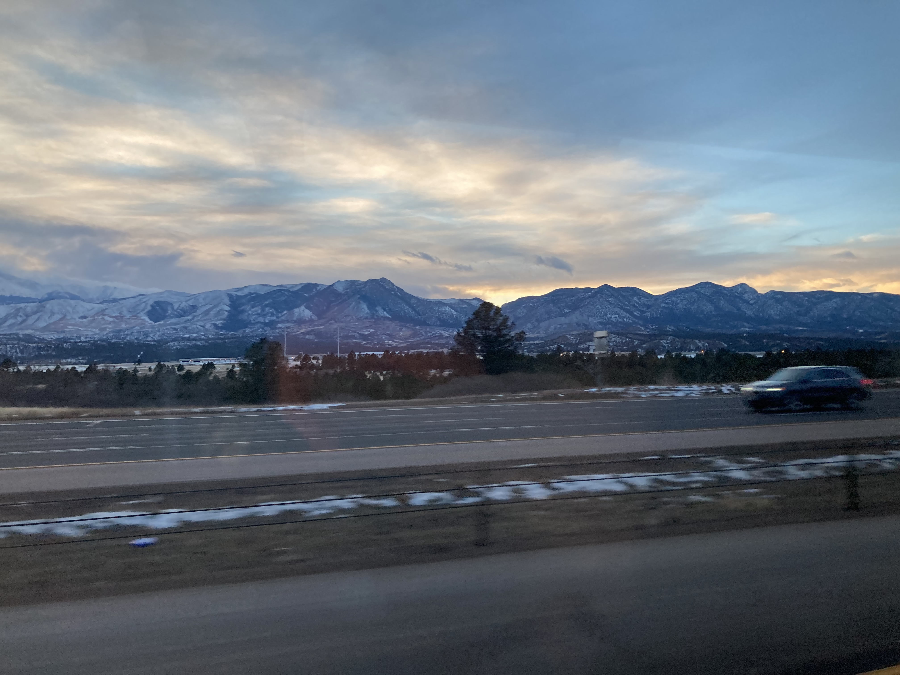
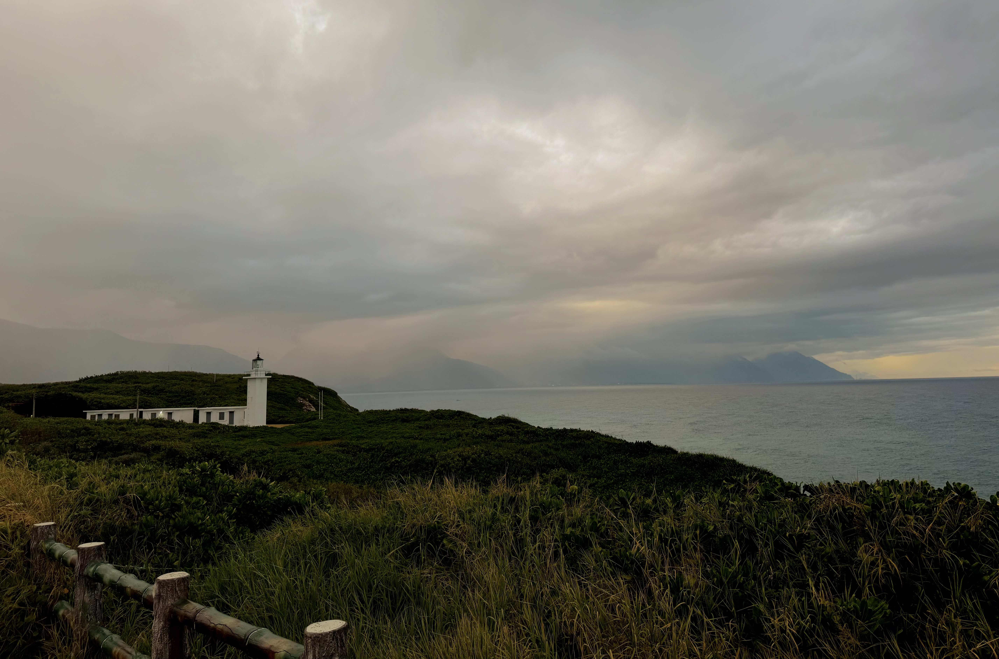
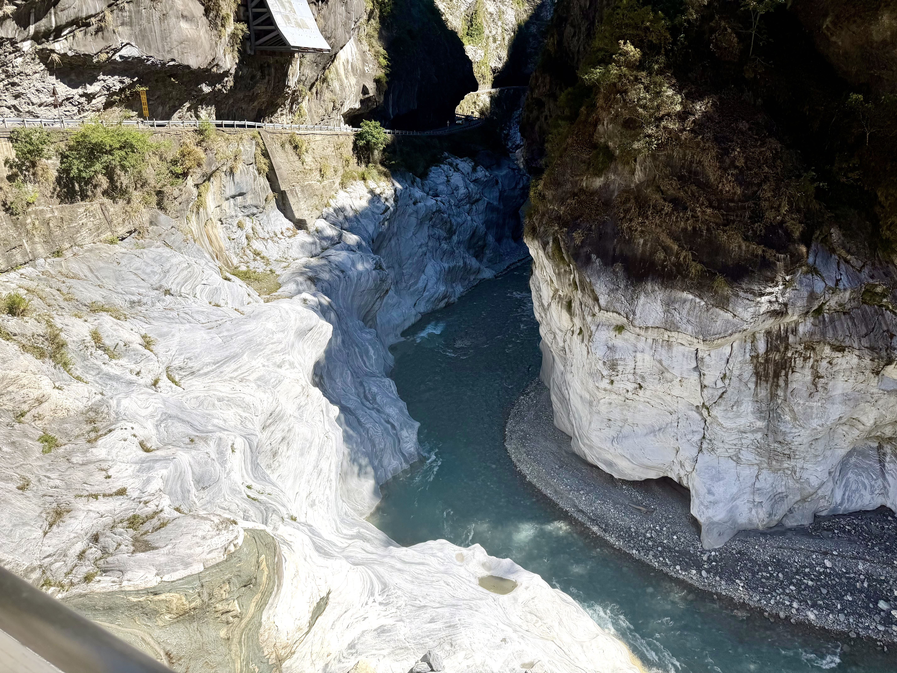
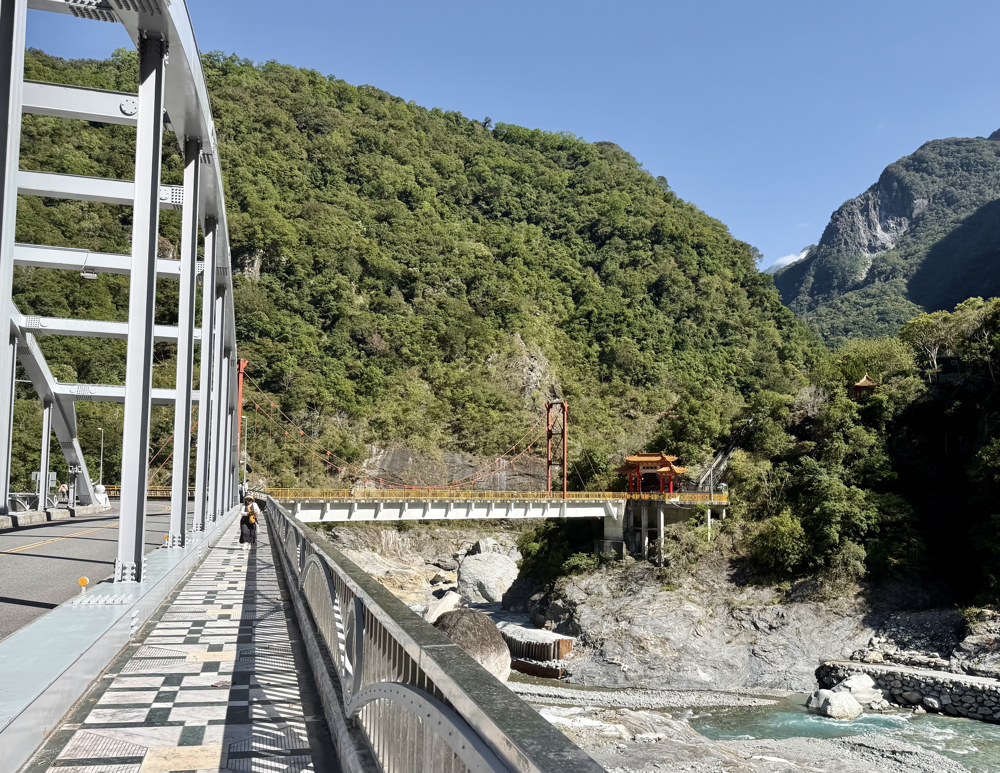
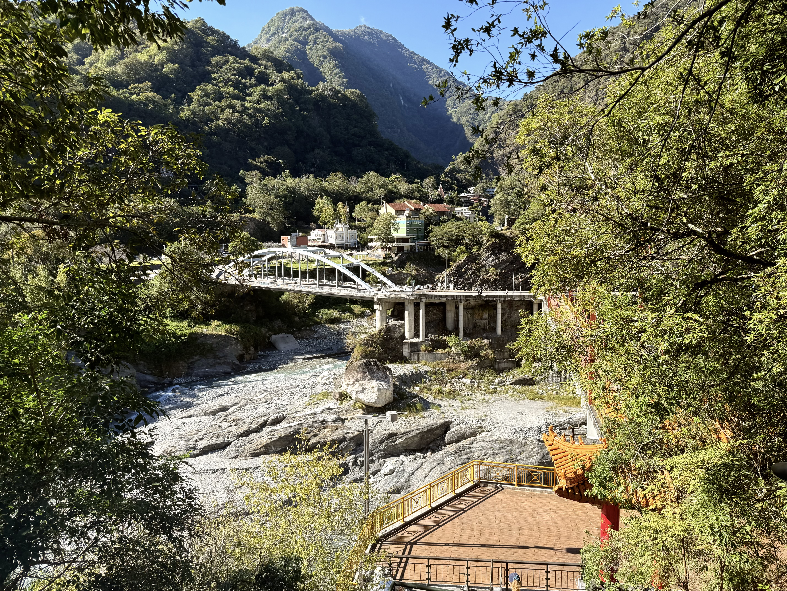
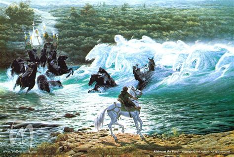
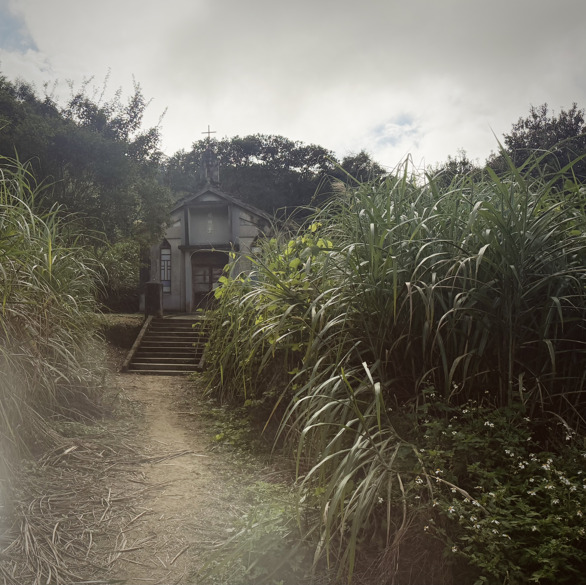
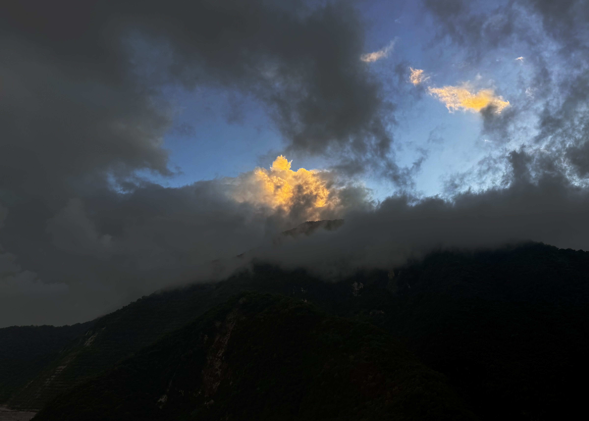
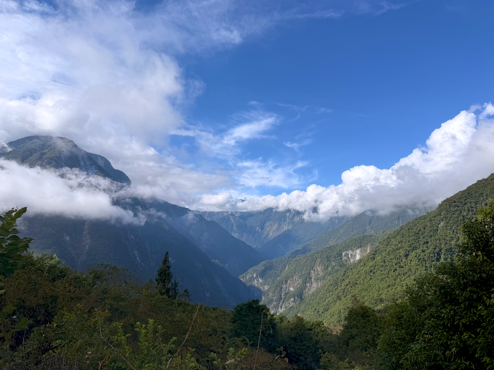

Formation of the Rocky Mountains is, apparently, an unsettled topic in geology. But here is the current theory. Basically, there is a plate boundary over by California. Ages ago the plate under the ocean slid under Cali and formed those mountains. Later, that plate rose again and pushed up the Rockies. Imagine a hog waking up from a long, long slumber and pushing of the accumulated mud from its back. A ridge of hard bone would rise above the mud. That ridge of hard bone is the hard granite that makes up (some of) the Rockies. But this story may not be the case, apparently there may be a hidden folded-plate-thingy in the lava instead. Woah.

*The Rockies for reference*

Formation of Taiwan is more settled for geologists, less so for the island. Here, two oceanic plates collided, and this created Taiwan. This collision is still happening, and the island rises little by little each year. Because the island used to be underwater, dead sea creatures deposited their bone-stuff onto the seafloor when they died. With time and pressure, this bone-stuff turned into hard, hard marble. When these ocean plates collided, the marble was forced up almost vertically.

*A lighthouse overlooking the ocean*

Marble lines the edges of Taroko Gorge. Taroko gorge is narrow and deep with white walls and rapids, with blue eddies and pools. Red bridges span the gorge at intervals, standing out from the verdant woods and plants clinging to sheer rock faces. Water shows its tenacity in erosion, and life in handholds. A temple sprawls across a half peak overlooking a small tourist town. I feel like Ive stepped into the front cover of a pre-written D&D adventure book. It is quite the sight.

*The Marble cliffs over the Liwu river, its bluer in person*

*A Beautifull couple of bridges that lead to the temple on the hill*

*Picture of the bridge I was standing on in the previous*

*Rivendell for refrence*

The day before I hiked into one of the mountains. It was almost 2k of elevation gain over 6k. I talked about a German about the rise of AfD; rooted in a crisis of meaning. At the top of the hike was an abandoned church. A tribe of indigenous Taiwanese people had lived here for centuries, resisting Japanese occupation and political changes until the opening of the inter mountain road that connected the east coast to the west coast. After this road opened and tourists began their own occupation, they moved further into the gorge, where they are still. There are still signs of settlement around the abandoned church, in rundown houses, abandoned ATVs, farmland, and a couple people drinking. The way down was worse than the way up. I reached the bottom just before night fall, and had to wait an hour for the next bus back to town. At the night market, I took terrible pictures of my food because I was starving. 

*The abandoned church*

*It looked like the Mountain was on fire*

*The peak*

I wondered all day why we climb mountains. I think it is for the same reason that the child asks "Warum bin ich ich und warum nicht du? Warum bin ich hier und warum nicht dort?" (*Why am I me and why not you? Why am I here, and not there?). 